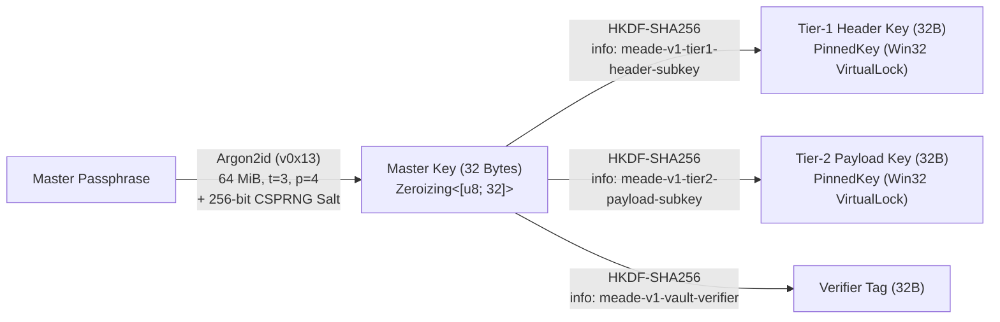

# Meade Architecture & Cryptographic Specification

This document details how **Meade** works internally: its Two-Tier Authenticated Encryption with Associated Data (AEAD) model, key derivation and memory pinning lifecycle, SQLite storage layout, sequential clipboard state machine, and threat model.

---

## 1. Design Philosophy: Why Not SQLCipher?

Most encrypted SQLite applications link `SQLCipher` (via `bundled-sqlcipher-vendored-openssl`). While full-database page encryption hides table structures on disk, it introduces two systemic liabilities for a credential and clipboard manager:
1. **Supply-Chain & FFI Surface:** Compiling vendored OpenSSL + SQLCipher pulls ~800,000 lines of C code, Perl/NASM build scripts, and C memory management into the binary.
2. **In-Memory Blast Radius:** Once a SQLCipher connection executes `PRAGMA key`, any query that scans a table decrypts 4KB B-tree pages into the SQLite page cache—meaning secret values sit decrypted in heap buffers simply because the user scrolled through a list of titles.

**Meade** achieves **both** on-disk metadata opacity and single-record memory isolation in **100% pure Rust** (`RustCrypto`) via a **Two-Tier Envelope Architecture**.

---

## 2. Cryptographic Key Hierarchy (`src/crypto/`)



### 2.1 Master Key Derivation (`Argon2id`)
When initializing (`meade init`) or unlocking (`meade unlock` / `meade tui`) a vault:
1. A 256-bit (32-byte) cryptographically random salt is generated via `OsRng` and stored in the `vault_meta` table.
2. The user's passphrase is fed into **Argon2id (`v0x13`)** configured with **64 MiB RAM (`65,536 KiB`), 3 iterations, and 4 parallelism lanes**, producing a 256-bit Root Master Key inside a `Zeroizing<[u8; 32]>` stack guard.

### 2.2 Subkey Isolation (`HKDF-SHA256`)
The Root Master Key is never used directly to encrypt database rows. Instead, **HKDF-SHA256** (salted with the vault's 32-byte salt) derives two cryptographically independent 256-bit subkeys, after which the Root Master Key is immediately zeroized:
- **Tier-1 Catalogue Header Subkey (`K_hdr`):** Derived with domain label `"meade-v1-tier1-header-subkey"`. Used exclusively to encrypt/decrypt `Tier1Header` metadata (`title`, `category`, `identity`, `url_or_host`, `tags`, `has_totp`).
- **Tier-2 Secret Payload Subkey (`K_sec`):** Derived with domain label `"meade-v1-tier2-payload-subkey"`. Used exclusively to encrypt/decrypt `Tier2Secret` payloads (`primary_secret`, `totp_secret`, `notes`).

### 2.3 Associated Data (AAD) Binding (`src/crypto/envelope.rs`)
Every Tier-1 and Tier-2 encryption operation uses **XChaCha20-Poly1305** with a fresh 192-bit (24-byte) `OsRng` nonce. Because XChaCha20 uses a 192-bit nonce, random nonce generation across billions of updates has a negligible collision probability ($< 2^{-96}$).

Crucially, every ciphertext is bound to its exact SQLite row UUID and envelope tier via AEAD **Associated Data (AAD)**:
```text
AAD = "meade-aad-v" || [0x01] || "|" || ("T1_HDR" | "T2_SEC") || "|" || <entry_uuid_v4_ascii>
```
**Security Consequence:** Even if an attacker has write access to the raw `.db` file on disk, they **cannot**:
- Swap the `tier2_ciphertext` of `"Staging Dummy Key"` with `"AWS Production Root"` (UUID mismatch in AAD triggers Poly1305 MAC rejection).
- Move a `tier2_ciphertext` into the `tier1_ciphertext` column to trick the TUI into displaying a secret as a title (`T1_HDR` vs `T2_SEC` tier tag mismatch in AAD + separate HKDF subkeys).

---

## 3. Non-Pageable Memory Hygiene (`src/crypto/memlock.rs`)

When `VaultKeys` are constructed in memory:
1. Both 32-byte subkeys are wrapped in `PinnedKey`, which allocates a fixed heap `Box<[u8; 32]>` and invokes Windows `VirtualLock(ptr, 32)`.
2. `VirtualLock` instructs the Windows kernel memory manager to pin the virtual page in physical RAM, preventing the OS from writing key material to `C:\pagefile.sys` under memory pressure.
3. When `PinnedKey` is dropped (or on `meade lock`), `Drop::drop` executes a volatile memory wipe (`self.inner.zeroize()`) *before* calling `VirtualUnlock`.
4. All transient decrypted secret buffers (`Tier2Secret`, TOTP decoded seeds, and envelope plaintexts) derive `Zeroize` and `ZeroizeOnDrop`.

---

## 4. Two-Tier SQLite WAL Storage (`src/db/`)

Meade opens its SQLite 3 database with four mandatory pragmas:
```sql
PRAGMA journal_mode = WAL;
PRAGMA synchronous = NORMAL;
PRAGMA foreign_keys = ON;
PRAGMA secure_delete = ON;
```
Setting `PRAGMA secure_delete = ON` ensures that when an entry is deleted (`meade` -> `d`) or updated, SQLite overwrites freed B-tree bytes with zeros on disk rather than leaving stale ciphertext blocks in unallocated pages.

### Schema Layout
1. **`vault_meta` (Single-Row Table, `CHECK (id = 1)`):**
   - `argon2_salt` (`BLOB`): 32-byte random salt.
   - `canary_nonce` (`BLOB`) & `canary_ciphertext` (`BLOB`): An `XChaCha20-Poly1305` envelope encrypting `"MEADE_VAULT_AUTHENTICATED_CANARY_V1"` under `AAD = "__meade_vault_canary_v1__"`. Used to verify master passphrase correctness in $O(1)$ time before loading the catalogue.
2. **`vault_entries`:**
   - `id` (`TEXT PRIMARY KEY`): UUIDv4 string.
   - `tier1_nonce` (`BLOB`, 24B) & `tier1_ciphertext` (`BLOB`): Encrypted JSON of `Tier1Header`.
   - `tier2_nonce` (`BLOB`, 24B) & `tier2_ciphertext` (`BLOB`): Encrypted JSON of `Tier2Secret`.
   - `created_at` (`INTEGER`) & `updated_at` (`INTEGER`): UTC Unix epoch seconds.

**Zero-Touch Browsing:** `VaultDb::list_catalogue()` executes:
```sql
SELECT id, tier1_nonce, tier1_ciphertext, created_at, updated_at FROM vault_entries ORDER BY updated_at DESC
```
Notice that `tier2_nonce` and `tier2_ciphertext` are **not even selected from SQLite** during catalogue browsing or fuzzy searching. `VaultDb::decrypt_secret()` is invoked for a single `id` only when the user presses `Enter`, `y`, `t`, or `r`.

---

## 5. Clipboard Interceptor Daemon & `Ctrl+Shift+V` Queue (`src/daemon/`)

### 5.1 Sequential Multi-Copy State Machine (`SequentialPasteQueue`)
Logging into a hardened service typically requires three sequential paste operations: **Username**, **Password**, and **6-Digit 2FA TOTP Code**. Instead of forcing the user to alt-tab back and forth three times, Meade's `SequentialPasteQueue` turns a single selection (`Enter`) into a stepped dispenser:

```mermaid
stateDiagram-v2
    [*] --> Stage1_Identity: Press Enter on Entry (or `meade queue <name>`)
    Stage1_Identity --> Stage2_Secret: Press Ctrl+Shift+V (or `n`)
    Stage2_Secret --> Stage3_LiveTOTP: Press Ctrl+Shift+V (if entry has TOTP seed)
    Stage2_Secret --> Scrubbed: Press Ctrl+Shift+V (if no TOTP seed) or TTL Expired
    Stage3_LiveTOTP --> Scrubbed: Press Ctrl+Shift+V or TTL Expired
    Scrubbed --> [*]: Overwrite clipboard with 32 zeros + arboard::clear()
```

- Notably, **Stage 3 (`TotpCode`)** does not pre-compute a static TOTP string when the queue starts (which might expire while you are typing your username). Instead, it stores the zeroizing TOTP seed and computes the **live RFC 6238 6-digit code** at the exact millisecond you advance into Stage 3.

### 5.2 Win32 Clipboard History & Cloud Exclusion (`src/daemon/clipboard.rs`)
Every time Meade places a stage onto the Windows clipboard, `apply_win32_clipboard_privacy_flags()` opens the thread clipboard and registers three Microsoft sentinel formats:
| Registered Win32 Clipboard Format | DWORD Value | Effect on Windows 10/11 |
| :--- | :--- | :--- |
| `ExcludeClipboardContentFromMonitorProcessing` | `1` | Instructs clipboard monitor hooks and third-party managers to ignore this payload. |
| `CanIncludeInClipboardHistory` | `0` | Prevents the secret from being recorded in the `Win+V` Clipboard History panel. |
| `CanUploadToCloudClipboard` | `0` | Prevents Windows from syncing the secret across devices via Microsoft Account Cloud Clipboard. |

---

## 6. Threat Model Summary

| Threat Vector | Mitigated? | Mechanism in Meade |
| :--- | :--- | :--- |
| **Offline Disk / Laptop Theft** | **Yes** | `Argon2id` (64 MiB, 3 iters) + Two-Tier `XChaCha20-Poly1305`. Zero plaintext titles, tags, usernames, or secrets exist in `vault.db`. |
| **Database Ciphertext Tampering / Row Swapping** | **Yes** | Every `XChaCha20-Poly1305` tag binds `entry_id` and `EnvelopeTier` into the AEAD Associated Data (`AAD`). |
| **OS Swap / Hibernation File Leakage (`pagefile.sys`)** | **Yes** | Active subkeys are pinned in physical RAM via Win32 `VirtualLock` and zeroized before `VirtualUnlock`. |
| **Accidental Secret Exposure During Screen Sharing** | **Yes** | TUI Catalogue only decrypts Tier-1 headers; Tier-2 secrets remain encrypted and masked (`••••••••`) unless `r` is explicitly toggled. |
| **Windows `Win+V` History & Cloud Clipboard Harvesting** | **Yes** | Every clipboard write sets `CanIncludeInClipboardHistory = 0`, `CanUploadToCloudClipboard = 0`, and `ExcludeClipboardContentFromMonitorProcessing = 1`. |
| **Stale Secret Left on Clipboard After Login** | **Yes** | Advancing past the final `Ctrl+Shift+V` stage or reaching the 20s TTL overwrites the clipboard with zeros and calls `clear()`. |
| **Root / Admin Kernel Debugger Attaching to Unlocked Process** | *Out of Scope* | An attacker with local Administrator / kernel `SeDebugPrivilege` running while the vault is actively unlocked can inspect process memory or hook keyboard input. Run `meade lock` when stepping away. |
