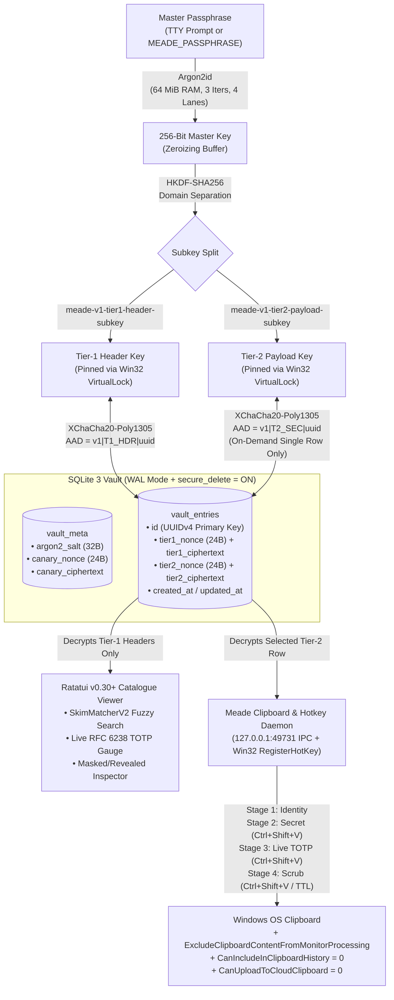

# Meade

**Pure-Rust Two-Tier AEAD Credential Vault, Win32 Clipboard Interceptor Daemon & Ratatui v0.30+ Catalogue Viewer**

[](LICENSE)
[](Cargo.toml)
[](ARCHITECTURE.md)
[](src/tui/ui.rs)

---

## 1. What Is Meade?

**Meade** is a high-assurance cryptographic credential vault, sequential clipboard dispenser daemon, and terminal catalogue viewer written in 100% safe, auditable Rust (2024 Edition).

Traditional password managers and developer secret tools fail at two critical boundaries:
1. **The C/OpenSSL Page-Cache Blast Radius:** Full-database encryption layers like `SQLCipher` link ~800,000 lines of C/OpenSSL FFI into your binary and decrypt entire 4KB B-tree pages into memory while you browse your catalogue. Conversely, naive SQLite secret stores leave entry titles (`"Production Stripe Root Key"`) and usernames in plaintext on disk.
2. **The OS Clipboard Broadcast Problem:** Copying a password or API token to the system clipboard exposes it to Windows Clipboard History (`Win+V`), Microsoft Cloud Clipboard sync, and every background Electron or telemetry process monitoring the clipboard chain.

**Meade** eliminates both vulnerabilities through three interlocking mechanisms:
- **Two-Tier Pure-Rust AEAD Envelope (`Argon2id` + `HKDF-SHA256` + `XChaCha20-Poly1305`):** Both **Tier-1 Catalogue Headers** (title, category, identity, URL/host, tags) and **Tier-2 Secret Payloads** (passwords, API keys, SSH/PEM private keys, RFC 6238 TOTP seeds, notes) are individually encrypted with unique 192-bit CSPRNG nonces and authenticated with row-bound Associated Data (`AAD = "meade-aad-v1" || tier || entry_uuid`). While you browse or fuzzy-search in the Ratatui TUI, **Tier-2 secret payloads remain 100% encrypted in memory and on disk**.
- **Non-Pageable RAM Custody (`VirtualLock` + `Zeroize`):** Derived subkeys are pinned in physical RAM via Win32 `VirtualLock` (preventing Windows from swapping key pages to `pagefile.sys`) and unconditionally overwritten with zeros on drop via `Zeroizing`. Optional Windows Credential Manager (`--keyring` DPAPI) session caching is supported.
- **Sequential Clipboard Dispenser (`Ctrl+Shift+V`) & Win32 Privacy Flags:** Dispatching a credential loads a bounded state machine in the daemon (`Stage 1: Identity/Username -> Stage 2: Password/Key -> Stage 3: Live 6-Digit TOTP -> Stage 4: Cryptographic Scrub`). Every clipboard write attaches Win32 `ExcludeClipboardContentFromMonitorProcessing`, `CanIncludeInClipboardHistory = 0`, and `CanUploadToCloudClipboard = 0` sentinel formats, and automatically scrubs the clipboard after a configurable TTL (default 20 seconds).

---

## 2. System Architecture



For a deep dive into the cryptographic envelope format, threat model, and memory lifecycle, see [**ARCHITECTURE.md**](ARCHITECTURE.md).

---

## 3. Quick Start (< 2 Minutes)

### Prerequisites
- **Rust Toolchain:** `rustc >= 1.85` (Rust 2024 Edition) — install via [rustup.rs](https://rustup.rs/)
- **OS:** Windows 10/11 (full `VirtualLock`, Win32 Clipboard Exclusion, and `RegisterHotKey` support), macOS, or Linux.

### Build & Run
```powershell
# Clone the repository
git clone https://github.com/tsiscoe/Meade.git
cd Meade

# 1. Initialize a new vault at ~/.meade/vault.db and seed 3 demo credentials
cargo run --release -- init --seed-demo

# 2. Launch the interactive Ratatui v0.30+ Catalogue Viewer
cargo run --release -- tui

# 3. (Optional) Install the `meade` binary globally to ~/.cargo/bin
cargo install --path .
```

See [**INSTALL.md**](INSTALL.md) for full installation, background daemon setup, and OS-specific instructions.

---

## 4. Ratatui v0.30+ Catalogue Viewer Keybindings

Launching `meade` (or `meade tui`) opens the three-pane terminal dashboard (**Categories Sidebar**, **Tier-1 Fuzzy Catalogue Table**, and **Tier-2 Cryptographic Inspector + Live TOTP Gauge**):

| Keybinding | Mode | Operational Action |
| :--- | :--- | :--- |
| `↑` / `↓` or `j` / `k` | Normal | Navigate credentials in the catalogue table |
| `Tab` / `Shift+Tab` or `←` / `→` | Normal | Cycle category filters (`All`, `Login`, `API`, `SSH`, `TOTP`, `Note`) |
| `/` | Normal -> Search | Activate real-time `SkimMatcherV2` fuzzy search across titles, identities, URLs, and tags (`Enter` or `Esc` locks filter) |
| `Enter` | Normal | **Queue Full Sequence:** Loads `Stage 1 (Identity) -> Stage 2 (Secret) -> Stage 3 (Live TOTP)` onto the clipboard |
| `Ctrl+Shift+V` or `n` | Any | **Advance Paste Queue:** Advances the sequential clipboard queue to the next stage (auto-scrubs after final stage) |
| `y` | Normal | Copy **Primary Secret** only (with Win32 privacy flags and 20s auto-scrub timer) |
| `u` | Normal | Copy **Identity / Username** only (with 20s auto-scrub timer) |
| `t` | Normal | Copy **Live 6-Digit RFC 6238 TOTP Code** only (with 20s auto-scrub timer) |
| `x` | Normal | **Panic Scrub:** Immediately overwrites and clears the OS clipboard and wipes the active queue |
| `r` | Normal | Toggle **Reveal / Mask** of the selected item's Tier-2 secret payload in the Inspector pane |
| `a` | Normal -> Modal | Open the **Add Credential** modal (`Tab` cycles fields, `←`/`→` selects category, `Enter` seals & saves) |
| `d` | Normal -> Modal | Open the **Confirm Secure Delete** modal (`y` deletes row and zeroes SQLite pages via `secure_delete = ON`) |
| `q` or `Esc` | Normal | Restore terminal state, scrub idle clipboard, and exit |

---

## 5. Headless CLI & Developer Workflows

Meade is built for both interactive terminal navigation and scriptable developer pipelines:

```powershell
# List all Tier-1 catalogue headers (never decrypts Tier-2 secrets)
meade list
meade list --query "aws"

# Add a new credential from the CLI (with optional RFC 6238 Base32 TOTP seed)
meade add \
  --title "GitHub Production Deploy Key" \
  --category api \
  --identity "org-deploy-bot" \
  --url "https://api.github.com" \
  --tags "github,ci,prod" \
  --secret "tok_demo_ExampleSecretToken1234567890" \
  --totp "JBSWY3DPEHPK3PXP"

# Start the background Clipboard Interceptor & Global Ctrl+Shift+V Hotkey Daemon
meade daemon serve --ttl 20

# Queue a credential into the running daemon from any shell
meade queue "AWS Production"
meade daemon status
meade daemon next
meade daemon scrub

# Import & Export Developer Secrets (.env, JSON, and ~/.ssh/config)
meade import --format dotenv --file ./.env --tag "backend-prod"
meade import --format ssh --file ~/.ssh/config --tag "infra-ssh"
meade export --format dotenv --tag "backend-prod" > .env.restored
meade export --format json > backup_export.json

# Lock session: purges OS Keyring, wipes Daemon VirtualLock RAM, and scrubs clipboard
meade lock
```

---

## 6. Documentation Index

| Document | Description |
| :--- | :--- |
| [**ARCHITECTURE.md**](ARCHITECTURE.md) | Deep technical specification: Two-Tier AEAD cryptography, AAD construction, `VirtualLock` memory pinning, Win32 clipboard exclusion flags, and threat model. |
| [**INSTALL.md**](INSTALL.md) | Step-by-step installation, Rust toolchain requirements, Windows background daemon setup, and troubleshooting. |
| [**CONTRIBUTING.md**](CONTRIBUTING.md) | Developer workflow, zero-`unwrap()` code standards, `TestBackend` UI testing, and security audit gates. |
| [**CHANGELOG.md**](CHANGELOG.md) | Release history and architectural milestones. |
| [**llms.txt**](llms.txt) | Machine-readable repository map and contract index for AI coding agents. |
| [**LICENSE**](LICENSE) | MIT License (`Copyright (c) 2026 tsiscoe`). |

---

## 7. License

Released under the [**MIT License**](LICENSE).
